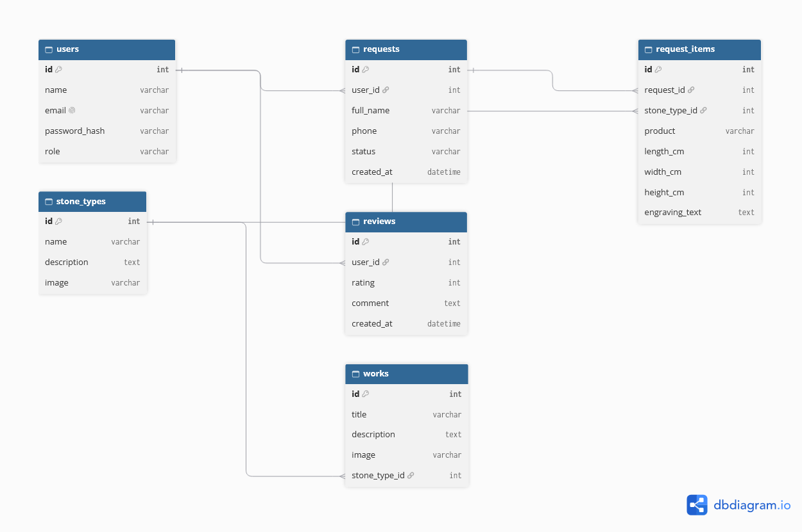

# Klesarstvo Mušanović

Web application for a family stone-crafting workshop. Customers browse stone types and finished works, register, and send requests for a quote (stairs, monuments, fireplaces, etc.). The admin manages the catalog and processes requests.

## Technologies
- Frontend: HTML, CSS, JavaScript (single-page application with a hash-based router), AJAX
- Backend (later milestones): PHP, FlightPHP (REST API), PDO
- Database: MySQL
- Authentication: JWT
- API documentation: OpenAPI / Swagger

## Project structure
- frontend/: css, js (router.js, script.js), views (HTML parts), assets (images), index.html
- backend/: routes, services, dao, middleware, config, logs
- docs/: erd.png, AI_LOG.md
- AGENTS.md

## Entities
- users: registered users (roles: admin, user)
- stone_types: types of stone (granite, marble, limestone...)
- works: gallery of finished works
- requests: a quote request sent by a customer
- request_items: items inside one request (product, stone, dimensions, engraving text)
- reviews: customer reviews

Relationships:
- one user has many requests and many reviews
- one request has many request_items
- one stone type is used in many request_items and many works

## Roles
- admin: full CRUD on all entities, processes requests
- user: sends requests, views own requests, writes reviews, views catalog

Test accounts (will be added in Milestone 4):
- admin: [email] / [password]
- user: [email] / [password]

## External API
Planned: weather forecast (OpenWeatherMap) shown on the request page, because installing outdoor stonework depends on the weather. Details will be added in Milestone 3.

## Running locally
1. Install XAMPP and start Apache.
2. Clone the repository into C:\xampp\htdocs.
3. Open http://localhost/your-folder/Projet-web/frontend/index.html
4. Backend setup (later milestones): import the .sql file and copy config.example.php to config.php.

## Links
- Swagger documentation: (Milestone 3)
- Deployed application: (Milestone 5)