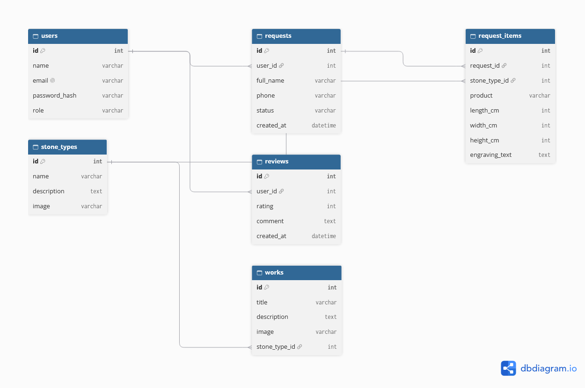

# Klesarstvo Mušanović

Web application for a family stone-crafting workshop. Customers browse stone types and finished works, register, and send requests for a quote (stairs, monuments, fireplaces, etc.). The admin manages the catalog and processes requests.

## Technologies
- Frontend: HTML, CSS, JavaScript (single-page application with a hash-based router), AJAX
- Backend: PHP, FlightPHP (REST API), PDO, Composer
- Database: MySQL
- Authentication: JWT (Milestone 4)
- API documentation: OpenAPI / Swagger (swagger-php)
- External API: OpenWeatherMap

## Project structure
- frontend/: css, js (router.js, script.js), views (HTML parts), assets (images), index.html
- backend/: routes, services, dao, openapi, middleware, config, logs, index.php
- docs/: erd.png, AI_LOG.md
- AGENTS.md

## Entities
- users: registered users (roles: admin, user)
- stone_types: types of stone (granite, marble, limestone...)
- works: gallery of finished works
- requests: a quote request sent by a customer
- request_items: items inside one request (product, stone, dimensions, engraving text)
- reviews: customer reviews

Relationships:
- one user has many requests and many reviews
- one request has many request_items
- one stone type is used in many request_items and many works

## Roles
- admin: full CRUD on all entities, processes requests
- user: sends requests, views own requests, writes reviews, views catalog

Test accounts (will be added in Milestone 4):
- admin: [email] / [password]
- user: [email] / [password]

## External API
OpenWeatherMap (current weather) is used on the request page, because installing outdoor stonework depends on the weather.
- Backend endpoint: GET /weather (returns city, temperature, feels like, humidity, description, wind).
- The backend calls OpenWeatherMap with a 5 second timeout. If the external API fails, the error is written to the error log and the endpoint returns 503 with a short message. The rest of the application keeps working.
- The API key is stored in backend/config/config.php (not committed). The weather feature will be shown in the user interface in Milestone 4.

## Running locally
1. Install XAMPP and start Apache and MySQL.
2. Clone the repository into C:\xampp\htdocs.
3. Open http://localhost/phpmyadmin, click Import and choose backend/database.sql.
4. Copy backend/config/config.example.php to backend/config/config.php and fill in the database credentials and your OpenWeatherMap API key (weather_api_key).
5. In the backend folder run: composer install (PHP needs the zip, curl, mbstring and pdo_mysql extensions enabled in php.ini).
6. Frontend: http://localhost/your-folder/Projet-web/frontend/index.html
7. API: http://localhost/your-folder/Projet-web/backend/ping

## Links
- Swagger documentation (local): http://localhost/your-folder/Projet-web/backend/docs
- OpenAPI JSON: http://localhost/your-folder/Projet-web/backend/openapi.json
- Deployed application: (Milestone 5)